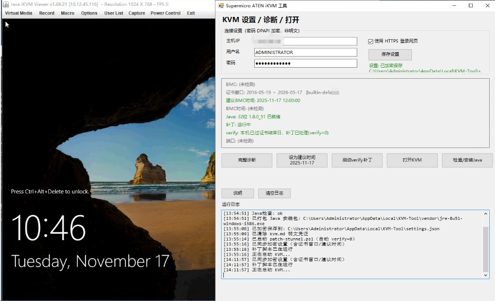

# 超微 ATEN iKVM 工具

老旧 **Supermicro / ATEN** 服务器的 Windows 侧辅助程序，用来在现在的电脑上打开早已过时的 **Java iKVM** 控制台。



## 开发来意

不少早期超微主板只有 Java 版 KVM，没有 HTML5 控制台。设备固件、证书和客户端都停在很多年前，放到今天的 Windows 环境里就会各种对不上：

- 依赖老旧的 Java Web Start / iKVM，和新系统、新浏览器、新版 Java 不兼容  
- 固件常常只有 **32 位**库，用 64 位 Java 打不开  
- KVM 隧道证书过期；本机时间或 BMC 时间不对就会 SSL 失败  
- 用 `javaws` 启动时还可能报 jar 签名错误（例如未签名条目）

做这个工具，是为了在**不换板、不升 BMC 固件**的情况下，让运维在现有电脑上仍能打开这些老机器的远程控制台：安装 32 位 Java 8u51、按证书窗口设置 BMC 时间、自动处理 stunnel `verify=0`，并用 `java` 直接启动，减少 Web Start 验签带来的麻烦。

## 功能

- 诊断：端口、Java、BMC 时间、证书窗口、补丁状态  
- 账号密码用 Windows DPAPI 加密保存（非明文）  
- 自动探测 KVM 证书允许时间，并给出建议 BMC 时间  
- 启动 stunnel `verify=0` 补丁  
- 检查 / 安装自带的 32 位 Java 8u51  
- 一键打开 KVM

## 使用方法

1. 运行 `KVM-Tool-Setup.exe`，或解压后运行 `启动KVM工具.bat` / `KVM-Tool-UI.exe`  
2. 需要时点「检查/安装Java」（安装包在 `vendor\`）  
3. 填写 BMC 地址、用户、密码并保存  
4. 按顺序：**完整诊断** → **设为建议时间** → **启动 verify 补丁** → **打开 KVM**

## 自行编译

```powershell
powershell -NoProfile -Command ". .\build\ps2exe.ps1; Invoke-ps2exe -inputFile .\kvm-tool-ui.ps1 -outputFile .\KVM-Tool-UI.exe -noConsole -STA -embedFiles @{'.\kvm-settings.ps1'='.\kvm-settings.ps1'; '.\kvm-java.ps1'='.\kvm-java.ps1'}"

powershell -File build\make-installer.ps1
```

请先准备 `vendor\jre-8u51-windows-i586.exe`（说明见 `vendor\README.txt`）。

## 目录说明

| 路径 | 说明 |
|------|------|
| `kvm-tool-ui.ps1` / `KVM-Tool-UI.exe` | 图形界面 |
| `open-kvm.ps1` | 登录、改 BMC 时间、启动控制台 |
| `patch-stunnel.ps1` | stunnel `verify=0` 补丁 |
| `kvm-settings.ps1` | 加密配置与证书窗口探测 |
| `kvm-java.ps1` | Java 检测/安装与直启逻辑 |
| `KVM-Tool-Setup.exe` | 单文件安装包 |
| `vendor\` | 离线 Java 8u51（32 位）安装包 |
| `docs/kvm-tool-demo.png` | 演示截图 |

## 注意

- 请勿把真实 BMC 密码提交进仓库；界面会加密保存在 `%LOCALAPPDATA%\KVM-Tool\`  
- 自带的 Oracle JRE 仅用于访问老旧 KVM，请自行确认许可是否允许分发  

## 许可

本仓库脚本按现状提供，供操作自有设备使用。第三方二进制（Oracle JRE、运行时从 BMC 下载的厂商 jar 等）仍遵循其各自许可。
